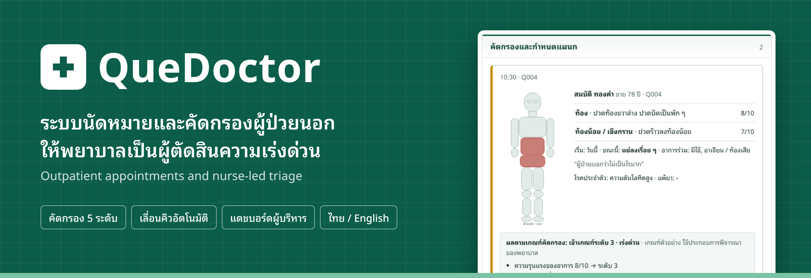
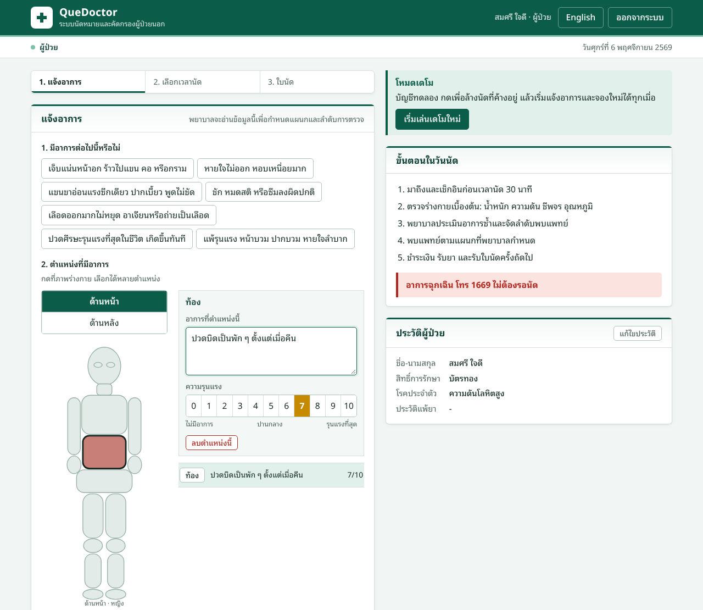
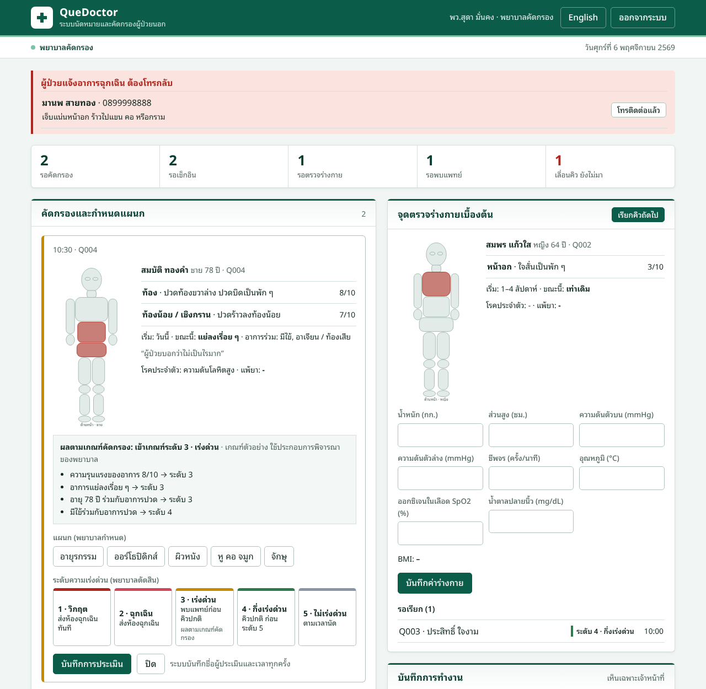
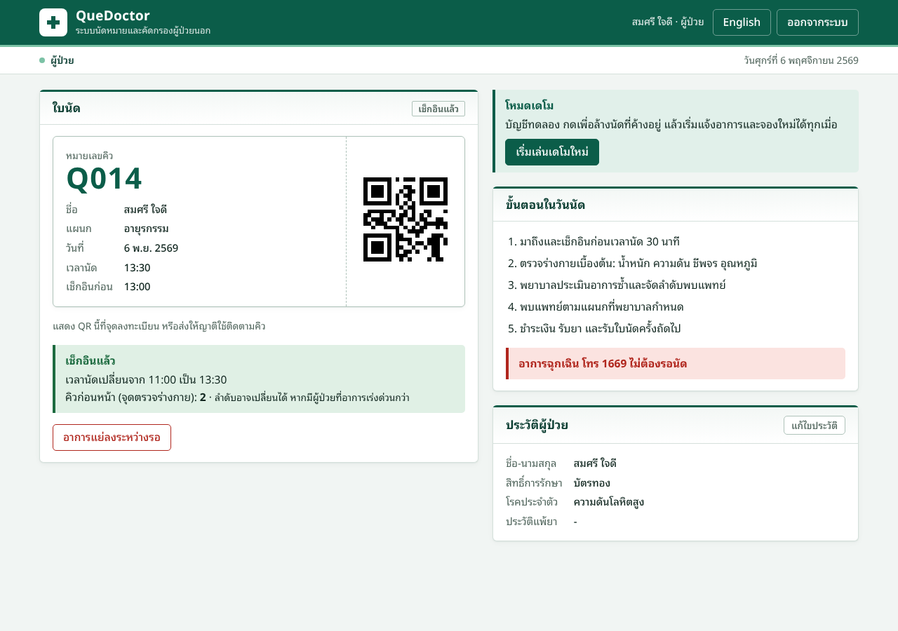
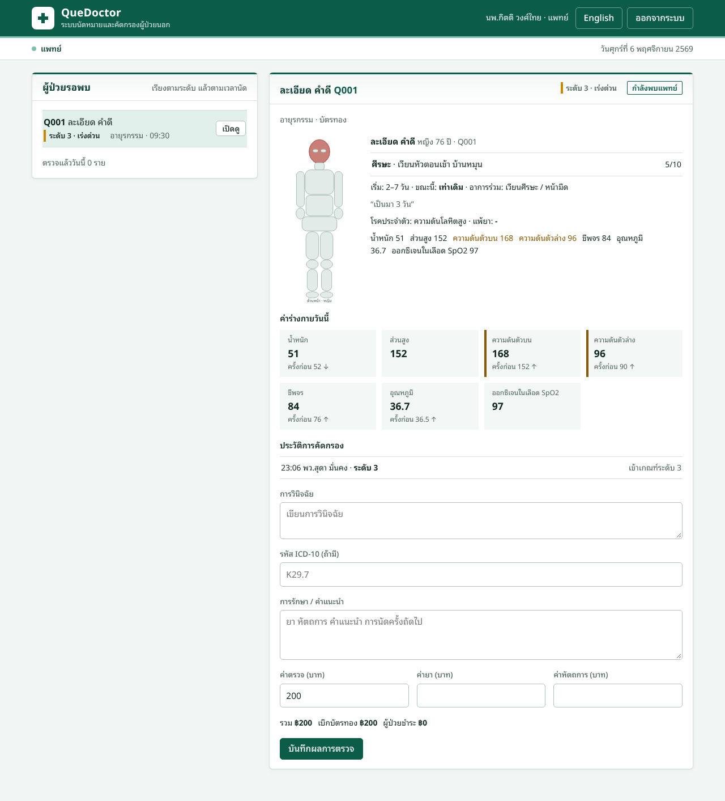
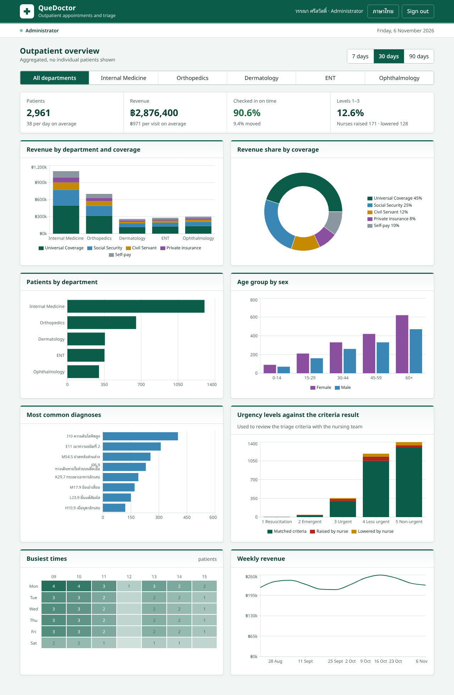
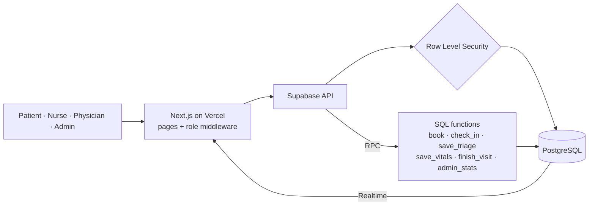
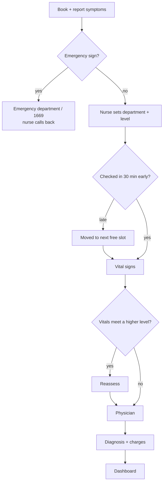
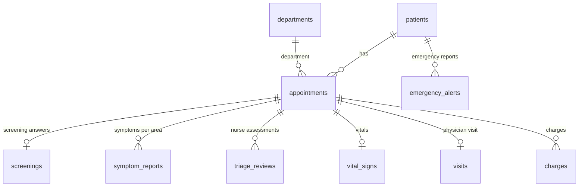

  

  <a href="https://quedoctor.vercel.app"><b>▶ Live demo</b></a> ·
  <a href="#try-it-in-2-minutes">Demo accounts</a> ·
  <a href="README.md">ภาษาไทย</a>

  
  
  
  
  

**QueDoctor** replaces first-come-first-served hospital queues with **timed appointments**. Patients describe their symptoms in advance on a body diagram, and a nurse sets the department and urgency level, helped by triage criteria that show their reasoning. Patients arrive 30 minutes before their time instead of queuing from dawn.

The interface is in Thai and English; this page describes the English version.

---

## Problem and approach

| Problem | How QueDoctor handles it |
|---|---|
| Older patients queue from dawn and wait all day | Timed slots with check-in 30 minutes before; late patients move to the next free slot automatically |
| Patients choose the wrong department and get passed around | Patients only describe symptoms; **the nurse assigns the department** |
| A seriously ill patient who says "it's nothing" waits in the regular queue, while a worried patient with mild symptoms is rushed | Five-level assessment from symptoms, age, trend and vital signs, every reason shown, final call by the nurse |
| Symptoms, vitals and diagnoses on paper; managers have nothing to plan with | One system with a dashboard by department, age, time, diagnosis and revenue |

---

## Try it in 2 minutes

Open **[quedoctor.vercel.app](https://quedoctor.vercel.app)**, switch to English at the top right, and pick a demo account. The password for every account is `KhiuMor-demo-2026`.

| Role | Email | Try this |
|---|---|---|
| Patient | `patient@khiumor.demo` | Report symptoms on the body diagram, pick a time, get the slip, check in |
| Nurse | `nurse@khiumor.demo` | Triage the appointment the patient just booked, read the criteria reasons, set department and level |
| Physician | `doctor@khiumor.demo` | Call a patient in, compare vitals with the last visit, write a diagnosis |
| Administrator | `admin@khiumor.demo` | Explore the dashboard |

> **Tip:** open two windows (one private) as patient and nurse to watch the queue update in real time. When you are done, press **Restart demo** on the patient page to play again.

---

## Features

### 1. Patients describe symptoms; they never choose a department
- Seven **emergency-sign questions** come first. Any match blocks booking, directs the patient to the emergency department or 1669, and asks a nurse to call back.
- Tap areas on a body diagram (female/male, front/back) and **write the symptoms in their own words** with a 0–10 severity.
- Onset, trend and associated symptoms.

### 2. Nurses decide, with criteria they can check
The system shows a **triage criteria result** with every reason, e.g. "age 78 with pain → level 3". **The nurse chooses the department and level.** Choosing a different level requires a written reason, and every assessment records who made it and when.

| Level | Meaning | Effect on the queue |
|:-:|---|---|
| 1 | Resuscitation | Emergency department now |
| 2 | Emergent | Emergency department |
| 3 | Urgent | Seen before the regular queue |
| 4 | Less urgent | Regular queue, before level 5 |
| 5 | Non-urgent | By appointment time |

Assessments happen at three points: before the visit, at the vital-signs station (vitals that meet a higher level force a reassessment before the physician), and whenever a patient reports **feeling worse while waiting**.

### 3. A queue that leaves nobody behind
- **Check in 30 minutes early.** Late patients are moved automatically, the queue moves up, and they get the next free slot on arrival.
- The appointment slip has a **QR code** relatives can use to follow the queue.
- Patients without a smartphone are **checked in by a nurse** at the counter.
- Patients can cancel or change their time until they check in.

### 4. Physicians see everything on one page
Patient-written symptoms, the body diagram, vitals compared with the previous visit, triage history, then a **free-text diagnosis** (optional ICD-10) with charges split by coverage.

### 5. Anonymised management dashboard
Patients by department · age group by sex · busiest times · common diagnoses · revenue by department and coverage (Universal Coverage, Social Security, Civil Servant, private insurance, self-pay) · how often nurses override the criteria, used to review the criteria with the nursing team.

---

## Engineering highlights

- **Security in the database.** Row level security separates four roles. Patients cannot read the appointments table; they see their own appointments through a function that strips urgency levels and other people. Administrators see aggregates only.
- **All writes go through database functions** that check the caller's role and write to an audit log.
- **No double booking under concurrency**, using a per-day advisory lock.
- **Automatic rescheduling** from check-in deadlines, with the next free slot found on arrival.
- **Real-time** nurse and physician screens via Supabase Realtime.
- **Triage criteria as a pure function** in its own module, covered by unit tests.
- **Bilingual UI**; TypeScript checks that every string exists in both languages.
- **CI** runs type checks, lint, tests and a build on every push.

## Architecture

### Patient flow

<b>Data model</b>

## Tech stack

| Layer | Tool |
|---|---|
| Web | Next.js 14 (App Router), React 18, TypeScript |
| Database / auth / realtime | Supabase (PostgreSQL, Row Level Security, Realtime) |
| Charts | Recharts |
| Tests / CI | Vitest, GitHub Actions |
| Hosting | Vercel |

<b>Run locally</b>

1. Node.js 18+, then `npm install`
2. Create a free project at [supabase.com](https://supabase.com)
3. In the Supabase **SQL Editor**, run the files in `supabase/migrations/` in filename order:
   1. `20261106000000_init.sql`
   2. `20261106010000_cancel.sql`
   3. `20261106020000_demo_reset.sql`
4. Copy `.env.example` to `.env.local` and fill in the URL, anon key and service role key (Project Settings → API)
5. `npm run seed` creates demo accounts, today's queue and 90 days of history
6. `npm run dev` and open http://localhost:3000
7. `npm test` runs the triage criteria tests

**On Vercel**, set only `NEXT_PUBLIC_SUPABASE_URL` and `NEXT_PUBLIC_SUPABASE_ANON_KEY`. Never expose the service role key.

## Notes

- **The criteria in `src/lib/triage.ts` are examples** that support, never replace, the nurse's judgement. Real thresholds must come from the hospital's clinical team and the triage guideline it uses.
- Claim ratios per coverage are placeholders.
- All patient data in the demo is fictional.

## Roadmap

- [ ] Compute the criteria level in the database as well, instead of trusting the browser
- [ ] LINE or SMS reminders before appointments
- [ ] Waiting-room display with Thai voice calls
- [ ] Relatives and village health volunteers booking for older patients
- [ ] Printed queue slips at the counter

## Author

Built by [@piyawanthaproject](https://github.com/piyawanthaproject) · [MIT License](LICENSE)
