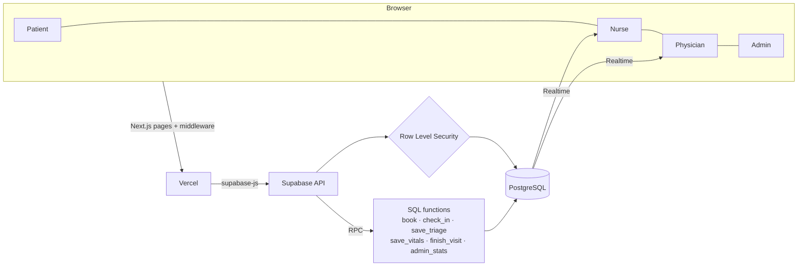
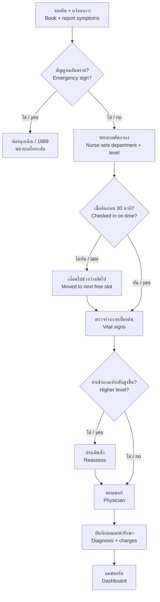

# QueDoctor

**ระบบนัดหมายและคัดกรองผู้ป่วยนอก ที่ให้พยาบาลเป็นผู้ตัดสินแผนกและระดับความเร่งด่วน**
Outpatient appointment and triage system where nurses decide the department and urgency level.

**🔗 เว็บจริง / Live demo: [quedoctor.vercel.app](https://quedoctor.vercel.app)**


[ภาษาไทย](#ภาษาไทย) · [English](#english) · [ภาพหน้าจอ / Screenshots](#ภาพหน้าจอ--screenshots)


---

## ลองเล่นเดโม / Try the demo

เปิด [quedoctor.vercel.app](https://quedoctor.vercel.app) แล้วกดเลือกบัญชีทดลองทางขวาของหน้าเข้าสู่ระบบ
Open the live site and pick a demo account on the sign-in page.

| บทบาท / Role | อีเมล / Email | รหัสผ่าน / Password |
|---|---|---|
| ผู้ป่วย / Patient | `patient@khiumor.demo` | `KhiuMor-demo-2026` |
| พยาบาล / Nurse | `nurse@khiumor.demo` | `KhiuMor-demo-2026` |
| แพทย์ / Physician | `doctor@khiumor.demo` | `KhiuMor-demo-2026` |
| ผู้บริหาร / Administrator | `admin@khiumor.demo` | `KhiuMor-demo-2026` |

**ลำดับที่แนะนำ / Suggested walkthrough**
1. **ผู้ป่วย** แจ้งอาการบนภาพร่างกาย → เลือกเวลา → เช็กอิน
2. **พยาบาล** คัดกรอง กำหนดแผนกและระดับ → เรียกคิว → กรอกค่าร่างกาย
3. **แพทย์** เรียกตรวจ → เขียนการวินิจฉัยและค่ารักษา
4. **ผู้บริหาร** ดูแดชบอร์ด
5. กลับไปเป็นผู้ป่วย กด **เริ่มเล่นเดโมใหม่** เพื่อเล่นซ้ำได้ทุกเมื่อ

เปิดสองหน้าต่าง (หนึ่งในนั้นเป็น Private/Incognito) เป็นผู้ป่วยกับพยาบาลพร้อมกัน จะเห็นคิวอัปเดตแบบเรียลไทม์
Use two windows (one private) as patient and nurse to watch the queue update in real time.

---

## ภาษาไทย

### ปัญหาที่แก้
- ผู้ป่วย โดยเฉพาะผู้สูงอายุ ต้องมารอตั้งแต่เช้ามืดเพราะระบบ "มาก่อนได้ก่อน"
- ผู้ป่วยเลือกแผนกเองไม่ถูก ถูกส่งต่อไปมา
- ผู้ป่วยที่อาการหนักจริงแต่บอกว่า "ไม่เป็นไรมาก" อาจรอคิวปกติ ส่วนคนที่กังวลมากอาจได้คิวด่วนทั้งที่อาการไม่หนัก
- ข้อมูลอาการ ค่าร่างกาย และการวินิจฉัยอยู่บนกระดาษ ผู้บริหารไม่มีข้อมูลวางแผน

### ฟีเจอร์
| ผู้ใช้ | ทำอะไรได้ |
|---|---|
| ผู้ป่วย | กรอกประวัติครั้งเดียว · ตอบคำถามสัญญาณอันตราย 7 ข้อ · กดตำแหน่งบนภาพร่างกาย (ชาย/หญิง หน้า/หลัง) แล้วเขียนอาการเอง พร้อมความรุนแรง 0–10 · เลือกเวลานัดโดยไม่ต้องเลือกแผนก · ใบนัดพร้อม QR · เช็กอินและดูคิว · แจ้งอาการแย่ลงระหว่างรอ · ยกเลิกหรือเปลี่ยนเวลาก่อนเช็กอิน |
| พยาบาล | เห็น "ผลตามเกณฑ์คัดกรอง" พร้อมเหตุผลทุกข้อ · กำหนดแผนกและระดับ 1–5 เอง (ต่างจากเกณฑ์ต้องเขียนเหตุผล) · เช็กอินแทนผู้ป่วยที่ไม่มีมือถือ · เรียกคิวตามระดับความเร่งด่วน · กรอกค่าร่างกาย ถ้าเข้าเกณฑ์ระดับสูงขึ้นต้องประเมินซ้ำ · รับแจ้งเตือนเมื่อผู้ป่วยแจ้งอาการฉุกเฉินหรืออาการแย่ลง |
| แพทย์ | เห็นข้อมูลทุกอย่างหน้าเดียว · ค่าร่างกายเทียบครั้งก่อน · ประวัติการคัดกรอง · เขียนการวินิจฉัย (ใส่รหัส ICD-10 ได้) · ค่ารักษาคำนวณส่วนเบิกตามสิทธิ์ |
| ผู้บริหาร | แดชบอร์ดไม่ระบุตัวบุคคล: ผู้ป่วยแยกแผนก ช่วงอายุ ช่วงเวลาหนาแน่น โรคที่พบบ่อย รายได้แยกแผนกและสิทธิ์การรักษา อัตราที่พยาบาลปรับระดับจากเกณฑ์ |

**กติกาเช็กอิน:** ต้องเช็กอินก่อนนัด 30 นาที ถ้าไม่ทัน ระบบเลื่อนคิวอัตโนมัติ คนถัดไปขยับขึ้น และเมื่อผู้ป่วยมาถึงจะได้ช่วงเวลาว่างถัดไป

**ระบบสองภาษา:** สลับไทย/อังกฤษได้ทุกหน้า

### ความปลอดภัยของข้อมูล
- ทุกการเขียนข้อมูลผ่านฟังก์ชันในฐานข้อมูลที่ตรวจบทบาทผู้เรียก
- Row Level Security: ผู้ป่วยอ่านตารางนัดหมายไม่ได้เลย เห็นนัดของตัวเองผ่าน `get_my_appointments()` ซึ่งไม่มีระดับความเร่งด่วนและไม่มีข้อมูลคนอื่น
- แพทย์เห็นเฉพาะผู้ป่วยที่ส่งมาพบ ผู้บริหารเห็นเฉพาะตัวเลขรวมผ่าน `admin_stats()`
- ทุกการกระทำบันทึกใน `audit_logs` พร้อมผู้ทำและเวลา

---

## English

### Problem
- Patients, especially older people, queue from dawn under first-come-first-served.
- Patients pick the wrong department and get passed between clinics.
- A seriously ill patient who says "it's nothing" can wait in the regular queue, while a worried patient with mild symptoms can be rushed.
- Symptoms, vital signs and diagnoses live on paper, so managers have nothing to plan with.

### Features
- **Patients** fill in their record once, answer 7 emergency-sign questions, tap areas on a body diagram and **write their own symptoms** with a 0–10 severity, then pick a time. **They never choose a department.** They get a QR slip, check in, follow the queue, can report feeling worse, and can cancel before check-in.
- **Nurses** see a transparent **triage criteria result** with every reason listed, then **set the department and a level from 1 to 5 themselves**. A level that differs from the criteria needs a written reason. Vital signs that meet a higher level force a reassessment before the physician.
- **Physicians** see everything on one page and **write the diagnosis as free text** (optional ICD-10), with treatment and charges split by coverage.
- **Administrators** see an anonymised dashboard: departments, age and sex, busiest times, common diagnoses, revenue by department and coverage, and how often nurses override the criteria.
- Patients must **check in 30 minutes early**; late patients are moved to the next free slot automatically.
- Thai / English on every page.

### Data protection
All writes go through role-checked database functions. Row level security keeps patients out of the appointments table, limits physicians to patients sent to them, and gives administrators aggregates only. Every action is written to an audit log.

---

## สถาปัตยกรรม / Architecture



### เส้นทางผู้ป่วย / Patient flow



---

## เทคโนโลยี / Tech stack
| ส่วน / Layer | เครื่องมือ / Tool |
|---|---|
| Frontend | Next.js 14 (App Router), React 18, TypeScript |
| Database / Auth / Realtime | Supabase (PostgreSQL, Row Level Security, Realtime) |
| Charts | Recharts |
| Tests / CI | Vitest, GitHub Actions |
| Hosting | Vercel |

## โครงสร้างโปรเจกต์ / Project structure
```
src/
  app/            หน้าเว็บแต่ละบทบาท / pages per role (login, patient, nurse, doctor, admin)
  components/     ส่วนประกอบหน้าจอ / UI pieces, body diagram, triage card
  lib/triage.ts   เกณฑ์คัดกรอง / triage criteria (+ triage.test.ts)
  lib/dict.ts     ข้อความไทย/อังกฤษ / Thai and English text
  middleware.ts   ส่งผู้ใช้ไปหน้าตามบทบาท / role routing
supabase/migrations/   ตาราง ฟังก์ชัน และสิทธิ์ / schema, functions, row level security
scripts/seed.mjs       ข้อมูลตัวอย่าง / demo data
```

## ติดตั้งในเครื่อง / Run locally
1. Node.js 18 ขึ้นไป แล้ว `npm install`
2. สร้างโปรเจกต์ฟรีที่ [supabase.com](https://supabase.com)
3. ใน Supabase **SQL Editor** รันไฟล์ใน `supabase/migrations/` **ตามลำดับชื่อไฟล์**:
   `20261106000000_init.sql` → `20261106010000_cancel.sql` → `20261106020000_demo_reset.sql`
4. คัดลอก `.env.example` เป็น `.env.local` แล้วใส่ URL, anon key และ service role key (Project Settings → API)
5. `npm run seed` ใส่บัญชีทดลอง คิววันนี้ และข้อมูลย้อนหลัง 90 วัน
6. `npm run dev` แล้วเปิด http://localhost:3000
7. `npm test` รันเทสต์เกณฑ์คัดกรอง

> Deploy บน Vercel ใส่แค่ `NEXT_PUBLIC_SUPABASE_URL` และ `NEXT_PUBLIC_SUPABASE_ANON_KEY` ห้ามใส่ service role key
> On Vercel set only the URL and anon key. Never expose the service role key.

## ข้อควรทราบ / Notes
- **เกณฑ์คัดกรองใน `src/lib/triage.ts` เป็นตัวอย่าง** ใช้ประกอบการตัดสินใจของพยาบาลเท่านั้น ก่อนใช้งานจริงต้องให้ทีมพยาบาลและแพทย์กำหนดเกณฑ์ตามแนวทางที่โรงพยาบาลใช้
  The criteria are examples that support, never replace, the nurse's judgement.
- อัตราเบิกตามสิทธิ์ใน `coverage_rates` เป็นค่าสมมติ / Claim ratios are placeholders.
- ข้อมูลทั้งหมดในเดโมเป็นข้อมูลสมมติ / All demo data is fictional.

## แผนพัฒนาต่อ / Roadmap
- [ ] คำนวณผลตามเกณฑ์ในฐานข้อมูลด้วย ไม่ต้องเชื่อค่าจากหน้าเว็บ / Compute the criteria level in the database too
- [ ] แจ้งเตือนผ่าน LINE หรือ SMS ก่อนนัด / LINE or SMS reminders
- [ ] จอเรียกคิวหน้าห้องพร้อมเสียงภาษาไทย / Waiting-room display with Thai voice calls
- [ ] ญาติหรือ อสม. จองแทนผู้สูงอายุ / Relatives and village health volunteers booking for older patients
- [ ] พิมพ์บัตรคิวที่เคาน์เตอร์ / Printed queue slips at the counter

## ภาพหน้าจอ / Screenshots
| | |
|---|---|
|  |  |
|  |  |

## License
[MIT](LICENSE)
