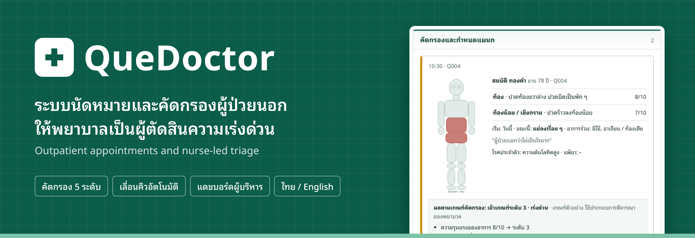
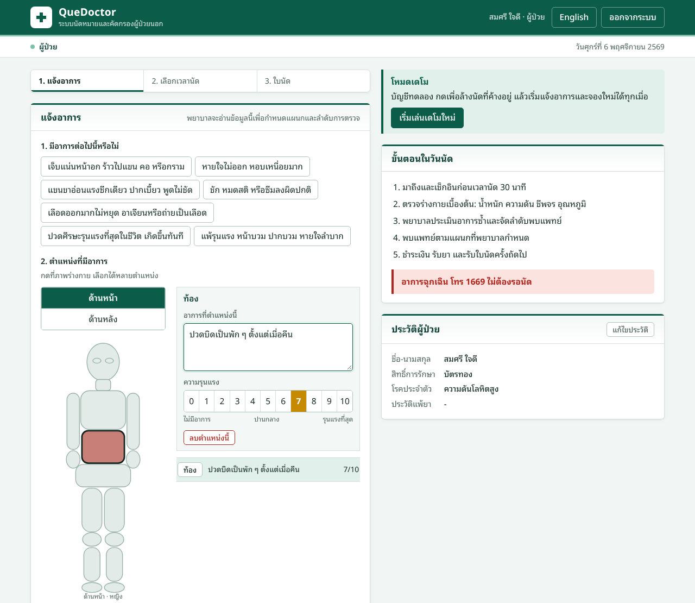
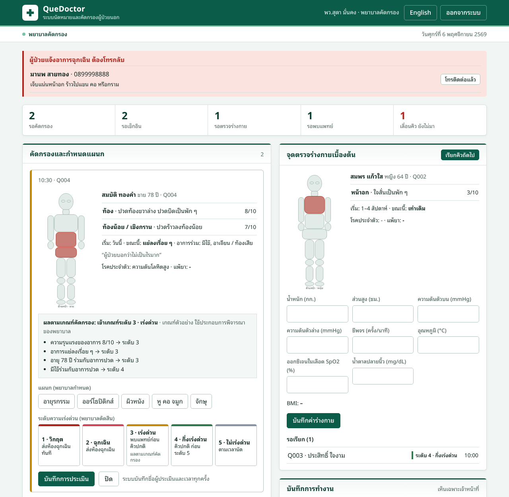
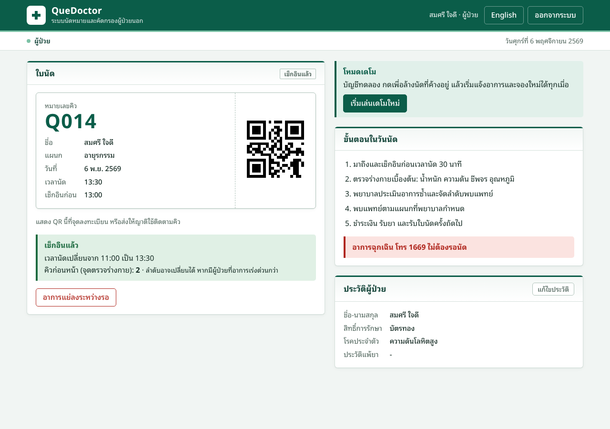
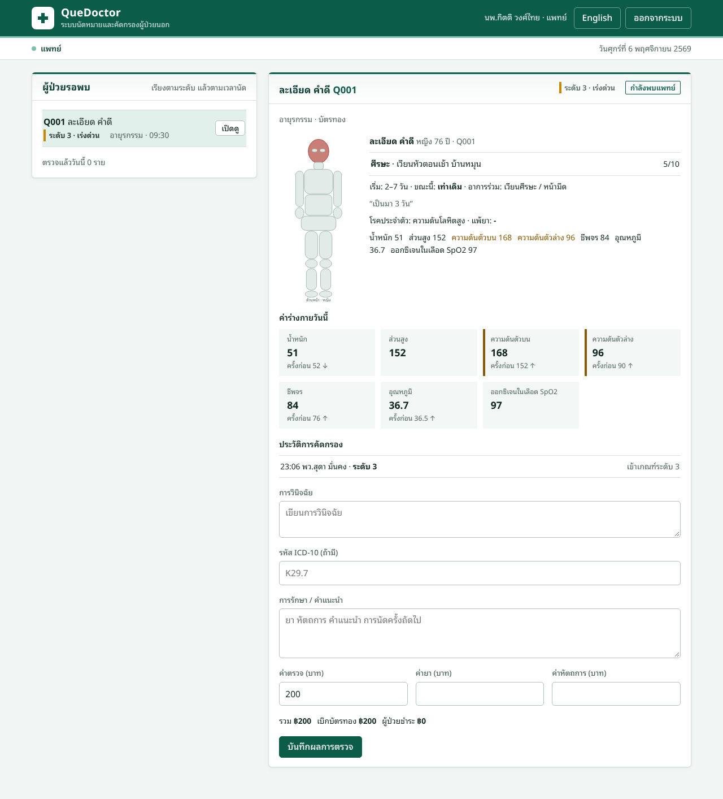
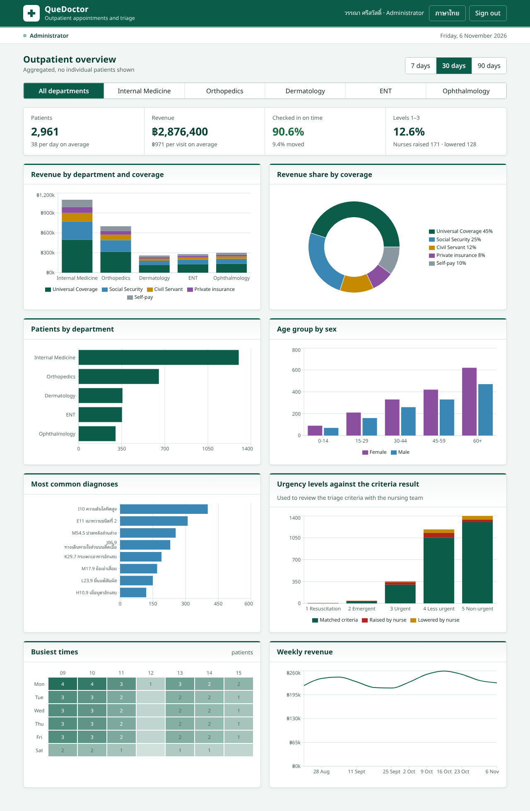
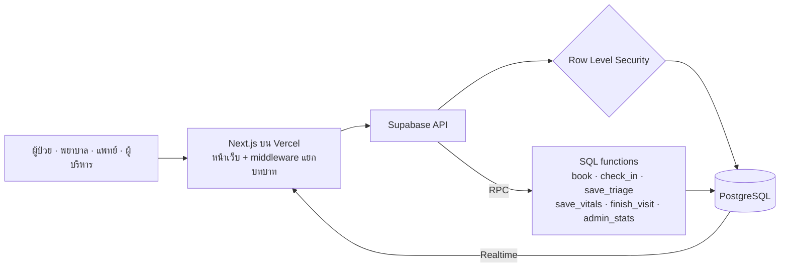
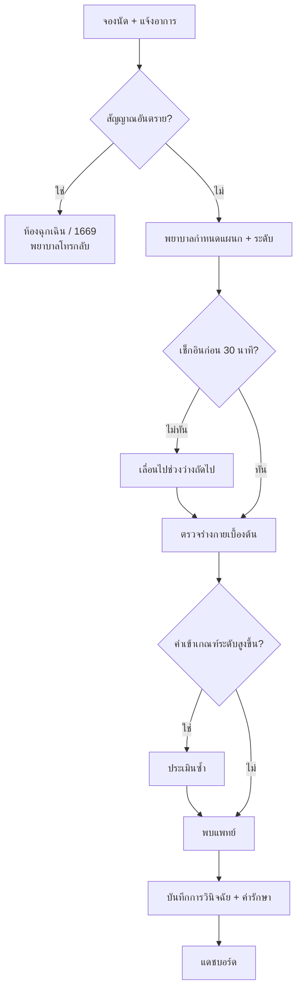
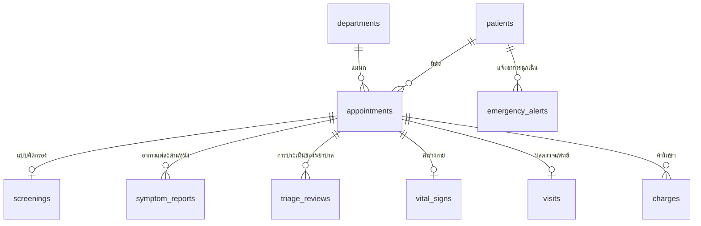

<p align="center">
  
</p>

<p align="center">
  <a href="https://quedoctor.vercel.app"><b>▶ ลองเล่นเดโม</b></a> ·
  <a href="#ลองเล่นใน-2-นาที">บัญชีทดลอง</a> ·
  <a href="README.en.md">English</a>
</p>

<p align="center">
  <a href="https://github.com/piyawanthaproject/quedoctor/actions/workflows/ci.yml"></a>
  
  
  
  
</p>

**QueDoctor** เปลี่ยนการรอคิวโรงพยาบาลแบบ "ใครมาก่อนได้ก่อน" เป็น **การนัดตามช่วงเวลา** ผู้ป่วยแจ้งอาการล่วงหน้าผ่านภาพร่างกาย พยาบาลเป็นผู้กำหนดแผนกและระดับความเร่งด่วน โดยมีเกณฑ์คัดกรองที่ตรวจสอบได้เป็นตัวช่วย ผู้ป่วยมาก่อนนัดแค่ 30 นาที ไม่ต้องรอตั้งแต่เช้ามืด

---

## ปัญหาและทางแก้

| ปัญหาเดิม | QueDoctor แก้อย่างไร |
|---|---|
| ผู้สูงอายุต้องมารอคิวตั้งแต่เช้ามืดและนั่งรอทั้งวัน | นัดเป็นช่วงเวลา เช็กอินก่อน 30 นาที ไม่ทันก็เลื่อนไปช่วงว่างถัดไปให้อัตโนมัติ ไม่ตกคิว |
| ผู้ป่วยเลือกแผนกไม่ถูก ถูกส่งต่อไปมา | ผู้ป่วยแจ้งแค่อาการ **พยาบาลเป็นคนเลือกแผนก** |
| คนอาการหนักแต่บอกว่า "ไม่เป็นไร" ได้คิวปกติ คนกังวลมากได้คิวด่วนทั้งที่อาการเบา | ประเมิน 5 ระดับจากอาการ อายุ แนวโน้ม และค่าร่างกาย แสดงเหตุผลทุกข้อ พยาบาลตัดสินขั้นสุดท้าย |
| อาการ ค่าร่างกาย การวินิจฉัย อยู่บนกระดาษ ผู้บริหารไม่มีข้อมูลวางแผน | ทุกอย่างอยู่ในระบบเดียว มีแดชบอร์ดแยกแผนก ช่วงอายุ ช่วงเวลา โรค และรายได้ |

---

## ลองเล่นใน 2 นาที

เปิด **[quedoctor.vercel.app](https://quedoctor.vercel.app)** แล้วกดเลือกบัญชีทดลองทางขวาของหน้าเข้าสู่ระบบ รหัสผ่านทุกบัญชีคือ `KhiuMor-demo-2026`

| บทบาท | อีเมล | ลองทำอะไร |
|---|---|---|
| ผู้ป่วย | `patient@khiumor.demo` | แจ้งอาการบนภาพร่างกาย เลือกเวลา รับใบนัด เช็กอิน |
| พยาบาล | `nurse@khiumor.demo` | คัดกรองนัดที่ผู้ป่วยเพิ่งจอง ดูเหตุผลตามเกณฑ์ แล้วเลือกแผนกและระดับ |
| แพทย์ | `doctor@khiumor.demo` | เรียกตรวจ ดูค่าร่างกายเทียบครั้งก่อน เขียนการวินิจฉัย |
| ผู้บริหาร | `admin@khiumor.demo` | ดูแดชบอร์ด ลองสลับเป็นภาษาอังกฤษ |

> **เคล็ดลับ** เปิด 2 หน้าต่าง (หนึ่งในนั้นเป็น Private) เป็นผู้ป่วยกับพยาบาลพร้อมกัน จะเห็นคิวขยับแบบเรียลไทม์ เล่นจบแล้วกด **เริ่มเล่นเดโมใหม่** ในหน้าผู้ป่วยเพื่อเล่นซ้ำได้

---

## ฟีเจอร์เด่น

### 1. ผู้ป่วยแจ้งอาการเอง ไม่ต้องเลือกแผนก
- ตอบคำถาม **สัญญาณอันตราย 7 ข้อ** ก่อนเสมอ ถ้าเข้าข่าย ระบบไม่ให้จองนัด แนะนำห้องฉุกเฉินหรือโทร 1669 และแจ้งพยาบาลให้โทรกลับ
- กดตำแหน่งบนภาพร่างกาย (ชาย/หญิง ด้านหน้า/ด้านหลัง) แล้ว **เขียนอาการด้วยคำพูดตัวเอง** พร้อมความรุนแรง 0–10
- ระบุว่าเริ่มเป็นเมื่อไร ดีขึ้นหรือแย่ลง และอาการร่วม



### 2. พยาบาลตัดสินด้วยเกณฑ์ที่ตรวจสอบได้
ระบบแสดง **ผลตามเกณฑ์คัดกรอง** พร้อมเหตุผลทุกข้อ เช่น "อายุ 78 ปี ร่วมกับอาการปวด → ระดับ 3" แต่ **พยาบาลเป็นคนเลือกแผนกและระดับเอง** ถ้าเลือกต่างจากเกณฑ์ต้องเขียนเหตุผล และระบบบันทึกชื่อผู้ประเมินกับเวลาทุกครั้ง

| ระดับ | ความหมาย | ผลต่อคิว |
|:-:|---|---|
| 1 | วิกฤต | ส่งห้องฉุกเฉินทันที |
| 2 | ฉุกเฉิน | ส่งห้องฉุกเฉิน |
| 3 | เร่งด่วน | พบแพทย์ก่อนคิวปกติ |
| 4 | กึ่งเร่งด่วน | คิวปกติ ก่อนระดับ 5 |
| 5 | ไม่เร่งด่วน | ตามเวลานัด |

ประเมินได้ 3 จุด: ก่อนวันนัด, ตอนวัดค่าร่างกาย (ถ้าค่าผิดปกติเข้าเกณฑ์ระดับที่สูงขึ้น ต้องประเมินใหม่ก่อนส่งพบแพทย์) และเมื่อผู้ป่วยกด **อาการแย่ลงระหว่างรอ**



### 3. คิวที่ไม่ทิ้งใคร
- **เช็กอินก่อนนัด 30 นาที** ถ้าไม่ทัน ระบบเลื่อนอัตโนมัติ คนถัดไปขยับขึ้น เมื่อมาถึงจะได้ช่วงเวลาว่างถัดไป
- ใบนัดมี **QR** ให้ญาติใช้ติดตามคิวแทนได้
- ผู้ป่วยที่ไม่มีมือถือ **พยาบาลเช็กอินแทน** ที่เคาน์เตอร์ได้
- ยกเลิกหรือเปลี่ยนเวลาได้จนกว่าจะเช็กอิน



### 4. แพทย์เห็นทุกอย่างในหน้าเดียว
อาการที่ผู้ป่วยเขียน ตำแหน่งบนภาพร่างกาย ค่าร่างกายเทียบกับครั้งก่อน ประวัติการคัดกรอง แล้ว **เขียนการวินิจฉัยเอง** (ใส่รหัส ICD-10 ได้) พร้อมค่ารักษาที่แยกส่วนเบิกตามสิทธิ์ให้อัตโนมัติ



### 5. แดชบอร์ดผู้บริหาร (ไม่ระบุตัวบุคคล)
ผู้ป่วยแยกแผนก · ช่วงอายุแยกเพศ · ช่วงเวลาที่หนาแน่น · การวินิจฉัยที่พบบ่อย · รายได้แยกแผนกและสิทธิ์การรักษา (บัตรทอง ประกันสังคม ข้าราชการ ประกันเอกชน ชำระเอง) · อัตราที่พยาบาลปรับระดับจากเกณฑ์ ใช้ทบทวนเกณฑ์ร่วมกับทีมพยาบาล



---

## จุดเด่นทางเทคนิค

- **ความปลอดภัยระดับฐานข้อมูล** ใช้ Row Level Security แยกสิทธิ์ 4 บทบาท ผู้ป่วยอ่านตารางนัดหมายไม่ได้เลย เห็นนัดตัวเองผ่านฟังก์ชันที่ตัดระดับความเร่งด่วนและข้อมูลคนอื่นออก ผู้บริหารเห็นได้แค่ตัวเลขรวม
- **ทุกการเขียนผ่านฟังก์ชันในฐานข้อมูล** ที่ตรวจบทบาทผู้เรียก และบันทึกลง audit log
- **กันจองซ้ำเมื่อกดพร้อมกัน** ด้วย advisory lock ต่อวัน
- **เลื่อนคิวอัตโนมัติ** ตามเวลาเช็กอิน และหาช่วงว่างถัดไปให้เมื่อผู้ป่วยมาถึง
- **อัปเดตเรียลไทม์** หน้าพยาบาลและแพทย์ผ่าน Supabase Realtime
- **เกณฑ์คัดกรองเป็นฟังก์ชันบริสุทธิ์** แยกไฟล์และมี unit test ครอบคลุมกรณีสำคัญ
- **สองภาษา** ไทย/อังกฤษทุกหน้า TypeScript ตรวจว่าทุกข้อความมีครบทั้งสองภาษา
- **CI** ตรวจ type, lint, เทสต์ และ build ทุกครั้งที่ push

## สถาปัตยกรรม



### เส้นทางผู้ป่วย



<details>
<summary><b>โครงสร้างฐานข้อมูล</b></summary>



</details>

## เทคโนโลยี

| ส่วน | เครื่องมือ |
|---|---|
| หน้าเว็บ | Next.js 14 (App Router), React 18, TypeScript |
| ฐานข้อมูล / ล็อกอิน / เรียลไทม์ | Supabase (PostgreSQL, Row Level Security, Realtime) |
| กราฟ | Recharts |
| ทดสอบ / CI | Vitest, GitHub Actions |
| โฮสต์ | Vercel |

<details>
<summary><b>ติดตั้งและรันในเครื่อง</b></summary>

1. ติดตั้ง Node.js 18 ขึ้นไป แล้วรัน `npm install`
2. สร้างโปรเจกต์ฟรีที่ [supabase.com](https://supabase.com)
3. ใน Supabase เปิด **SQL Editor** แล้วรันไฟล์ใน `supabase/migrations/` ตามลำดับชื่อไฟล์
   1. `20261106000000_init.sql`
   2. `20261106010000_cancel.sql`
   3. `20261106020000_demo_reset.sql`
4. คัดลอก `.env.example` เป็น `.env.local` ใส่ค่า URL, anon key และ service role key จาก Project Settings → API
5. `npm run seed` สร้างบัญชีทดลอง คิววันนี้ และข้อมูลย้อนหลัง 90 วัน
6. `npm run dev` แล้วเปิด http://localhost:3000
7. `npm test` รันเทสต์เกณฑ์คัดกรอง

**Deploy บน Vercel** ใส่ environment variables แค่ `NEXT_PUBLIC_SUPABASE_URL` และ `NEXT_PUBLIC_SUPABASE_ANON_KEY` ห้ามใส่ service role key

</details>

<details>
<summary><b>โครงสร้างโปรเจกต์</b></summary>

```
src/
├─ app/                 หน้าเว็บ: login, patient, nurse, doctor, admin
├─ components/          ส่วนประกอบหน้าจอ ภาพร่างกาย การ์ดคัดกรอง
├─ lib/
│  ├─ triage.ts         เกณฑ์คัดกรอง
│  ├─ triage.test.ts    เทสต์เกณฑ์คัดกรอง
│  ├─ dict.ts           ข้อความไทย/อังกฤษ
│  └─ body.ts           ตำแหน่งบนภาพร่างกาย
└─ middleware.ts        ส่งผู้ใช้ไปหน้าตามบทบาท
supabase/migrations/    ตาราง ฟังก์ชัน และสิทธิ์การเข้าถึง
scripts/seed.mjs        ข้อมูลตัวอย่าง
```

</details>

## ข้อควรทราบ

- **เกณฑ์คัดกรองใน `src/lib/triage.ts` เป็นตัวอย่าง** ใช้ประกอบการตัดสินใจของพยาบาลเท่านั้น ก่อนใช้งานจริงต้องให้ทีมพยาบาลและแพทย์กำหนดเกณฑ์ตามแนวทางที่โรงพยาบาลใช้
- อัตราเบิกตามสิทธิ์การรักษาเป็นค่าสมมติ
- ข้อมูลผู้ป่วยในเดโมเป็นข้อมูลสมมติทั้งหมด

## แผนพัฒนาต่อ

- [ ] คำนวณผลตามเกณฑ์ในฐานข้อมูลด้วย ไม่ต้องเชื่อค่าจากหน้าเว็บ
- [ ] แจ้งเตือนผ่าน LINE หรือ SMS ก่อนถึงเวลานัด
- [ ] จอเรียกคิวหน้าห้องตรวจพร้อมเสียงเรียกภาษาไทย
- [ ] ญาติหรือ อสม. จองแทนผู้สูงอายุ
- [ ] พิมพ์บัตรคิวที่เคาน์เตอร์

## ผู้พัฒนา

พัฒนาโดย [@piyawanthaproject](https://github.com/piyawanthaproject) · สัญญาอนุญาต [MIT](LICENSE)
